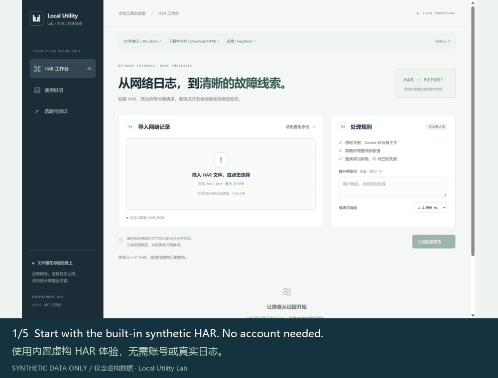

# 30-second walkthrough / 30 秒演示

[Play / 播放](https://nyxorbithq.github.io/local-utility-lab/demo/) · [Try / 试用](https://nyxorbithq.github.io/local-utility-lab/)

## English

Five screenshot states, six seconds each (30 seconds total). The GIF loops in supporting Markdown viewers; the web version starts only on Play and supports Pause, Previous, Next and Restart. It pauses when the page becomes hidden.

Frames are captured from the real app using the built-in fictional `example.com` HAR, not customer traffic or a continuous video recording. Bilingual captions explain the Chinese interface. The demo does not read user files, call models or trigger automatic downloads.

| Time | Caption |
| --- | --- |
| 00–06s | Start with the built-in synthetic HAR. No account needed. |
| 06–12s | Review failed and slow requests, then inspect the status and timing. |
| 12–18s | Preview the sanitized HAR. Bodies, credentials and query values are removed. |
| 18–24s | Review the AI-ready evidence brief. Nothing is sent to a model. |
| 24–30s | Export HAR or Markdown, then inspect business details before sharing. |

Expected sample results at 2,000 ms: six requests, three failed/no-response, two slow, P95 3,800 ms. These describe the fictional sample only.

Assets: `docs/assets/step-1.jpg` to `step-5.jpg`, `preview.jpg`, `demo.gif`. Build copies five frames to `dist/media/`; no runtime media library. Capture new frames when relevant UI changes. `scripts/make-demo.py` assembles screenshots using Pillow, which is only a media-authoring dependency. Set `DEMO_FONT` to a CJK font on non-Windows systems. Never capture private logs.

## 简体中文

五个截图状态，每个六秒，总计 30 秒。GIF 在支持的 Markdown 查看器中循环播放；网页版需主动点击播放，支持暂停、上一步、下一步和重来，页面隐藏时暂停。

截图来自真实应用与内置虚构 `example.com` HAR，不是真实客户流量或连续录屏。双语字幕解释当前中文界面。演示不读取用户文件、不调用模型、不自动触发下载。

| 时间 | 字幕 |
| --- | --- |
| 00–06 秒 | 使用内置虚构 HAR 体验，不需要账号或真实日志。 |
| 06–12 秒 | 查看异常和慢请求，核对状态与耗时。 |
| 12–18 秒 | 预览脱敏 HAR；正文、凭据和查询参数值均已移除。 |
| 18–24 秒 | 检查供 AI 分析的材料；页面不会向模型发送内容。 |
| 24–30 秒 | 导出 HAR 或 Markdown，人工检查业务信息后再分享。 |

2,000 ms 阈值下，示例有六条请求、三条异常／无响应、两条慢请求、P95 为 3,800 ms，仅描述虚构样本。

素材位于 `docs/assets/`。界面相关部分变化后应重新截图。`scripts/make-demo.py` 用 Pillow 合成双语 GIF；应用构建和运行不需要 Python。非 Windows 环境可用 `DEMO_FONT` 指定中文字体。禁止使用真实日志制作素材。

